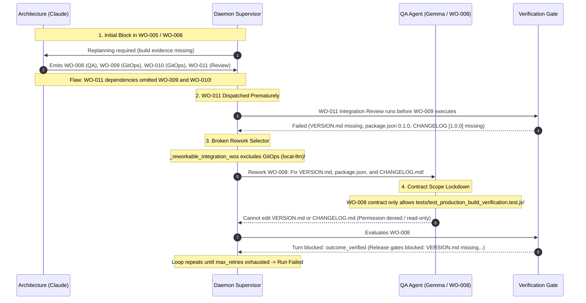

# StackMind Runtime & TUI Incident Investigation Report

**Incident Date:** October 24, 2026  
**Session ID:** `cba21535-3c1f-4b66-9631-23c52eeb1916`  
**Active Project:** `W:\Aatish\Stuff\clean_tui_ornith`  
**CLI Repository:** `W:\Aatish\Stuff\stackmind-cli`  
**Investigation Mode:** Read-Only Technical Audit (Zero code modifications)

---

## 1. Executive Summary

During an extended multi-agent execution session in the StackMind Terminal User Interface (TUI), a cascade of operational issues occurred across four distinct phases:
1. **Chat Stalling & Operation Contention:** The user interface appeared to freeze after an Architecture agent update. User attempts to submit prompts (`?`, `ss`) were rejected with `[ERROR] Could not submit turn: session already has an active operation`.
2. **Contract Scope Gate Failures:** Frontend agent operations were repeatedly blocked by `CONTRACT_SCOPE_VIOLATION` after Next.js internally modified files inside `node_modules/next/dist/...`.
3. **Daemon Memory Exhaustion (`MemoryError`):** After 1,749+ events and 69 journal entries accumulated, an RPC request to serialize session history triggered a fatal `MemoryError` inside Python's `json.dumps()` in `validators/kernel/daemon/server.py:60`.
4. **Terminal Screen Corruption:** The standard library `socketserver` error handler blasted raw traceback text directly to `sys.stderr`, corrupting the active Textual TUI screen beneath the composer widget.

```mermaid
flowchart TD
    subgraph S1["Phase 1: Chat Stall & Operation Contention"]
        A[Architect dispatches work to Frontend] --> B[Frontend agent executes in background]
        B --> C[TUI transcript does not attach to live worker stream]
        C --> D["User enters '?', 'ss'"]
        D --> E["OperationContentionError: session already has an active operation"]
    end

    subgraph S2S3["Phases 2 & 3: Scope Contract Violations"]
        F[Frontend edits app/page.tsx & runs build/dev] --> G["Next.js runtime touches node_modules/next/..."]
        G --> H[Contract Gate diffs workspace against allowed scope]
        H --> I["CONTRACT_SCOPE_VIOLATION: node_modules/..."]
        I --> J[Turn blocked; enters execution incident loop]
    end

    subgraph S4["Phase 4: Daemon MemoryError & Screen Bleed"]
        K["Session history grows (1,749+ events, 69 journal items)"] --> L["TUI/Client polls RPC event.list / session.get"]
        L --> M["server.py:_send() runs json.dumps(body)"]
        M --> N["MemoryError: CPython heap cannot allocate contiguous buffer"]
        N --> O["socketserver.handle_error prints to sys.stderr"]
        O --> P[Raw traceback bleeds over Textual console buffer]
    end
```



---

## 2. Chronological Stage-by-Stage Analysis

### 2.1 Stage 1: UI Stalling & Active Operation Contention (Screenshot 1)

* **Observed Behavior:**
  * The main conversation view displayed the status message:
    > *"I'm keeping a close eye on the Work Order board—everything is proceeding exactly according to the plan!"*
  * The user submitted multiple queries (`?`, `ss`, `?`).
  * The system rejected every submission with:
    `[ERROR] Could not submit turn: session already has an active operation`.
  * The right sidebar showed:
    * `AGENTS: Architecture orchestrating, Frontend implementing, Backend completed`
    * `CURRENT OPERATION: Frontend · ollama / Frontend (running)`
    * `WORK ORDERS: WO-000 to WO-002 completed, WO-003 running`
* **Root Cause:**
  * **Architect-to-Worker Handoff:** The Architecture agent completed its turn and delegated implementation of `WO-003: Content Integration` to the `Frontend` worker agent in the daemon supervisor.
  * **TUI Decoupling:** In the TUI, the conversation window only rendered completed turns. It did not automatically tail or stream intermediate thoughts and tool calls from background operations triggered by sub-agents.
  * **Mutual Exclusion Lock:** When the user attempted to type, the TUI dispatched `turn.submit` to the daemon. In `validators/kernel/daemon/manager.py:2036`, the session lock checked if an operation was in flight:
    ```python
    if active_operation is not None:
        raise OperationContentionError("session already has an active operation")
    ```
  * Because the Frontend worker was actively processing on Ollama (`gemma4:31b-cloud`), the daemon rejected new turns to prevent race conditions. The user experienced this as a frozen interface that refused input.

---

### 2.2 Stages 2 & 3: Scope Violations in `node_modules` (Screenshots 2 & 3)

* **Observed Behavior:**
  * Diffs were rendered showing modifications to `app/page.tsx` and image assets in `public/images`.
  * The turn abruptly failed with:
    `Turn blocked: CONTRACT_SCOPE_VIOLATION: Modification to file node_modules/next/dist/client/components/react-dev-overlay/internal/helpers/get-socket-url.js is outside allowed contract scope`.
  * The user prompted `done?` and again received `[ERROR] Could not submit turn: session already has an active operation`.
* **Root Cause:**
  * **Boundary Gate Design:** Work Orders define strict filesystem boundary contracts (e.g., `WO-003` only permits writes to `app/**`, `components/**`, and `public/**`).
  * **Snapshot False Positive:** When testing or building the Next.js application (`npm run build` / `next dev`), Next.js touched internal runtime helper files inside `node_modules/next/dist/client/.../get-socket-url.js`.
  * StackMind's filesystem snapshot engine (`validators/harness/snapshot.py`) compared full workspace state before and after the tool execution.
  * Because `node_modules/`, `.next/`, and `.turbo/` were not filtered out of change detection, the contract validator (`validators/harness/contract_gate.py`) flagged the Next.js runtime update as an unauthorized tampering attempt, aborting the turn and initiating an execution incident loop.

---

### 2.3 Stage 4: Daemon Heap Exhaustion (`MemoryError`) & Terminal Corruption (Screenshot 4)

* **Observed Behavior:**
  * The TUI rendered test suite diffs for `WO-004` and `package.json`.
  * Context reached `187.7K / 262.1K (72%)`.
  * Under the composer line `> -----------------------------------`, an unhandled Python traceback appeared:
    ```text
    Exception occurred during processing of request from ('127.0.0.1', 50489)
    Traceback (most recent call last):
      File ".../socketserver.py", line 691, in process_request_thread
      File ".../socketserver.py", line 361, in finish_request
      File ".../socketserver.py", line 755, in __init__
      File ".../http/server.py", line 436, in handle
      File ".../http/server.py", line 424, in handle_one_request
      File "W:\Aatish\Stuff\stackmind-cli\validators\kernel\daemon\server.py", line 145, in do_POST
      File "W:\Aatish\Stuff\stackmind-cli\validators\kernel\daemon\server.py", line 60, in _send
      File ".../json/__init__.py", line 231, in dumps
      File ".../json/encoder.py", line 200, in encode
      File ".../json/encoder.py", line 258, in iterencode
    MemoryError
    ```
* **Root Cause:**
  This failure is a collision of two architectural deficiencies:

  #### A. Unbounded Monolithic JSON Serialization
  * Over 6 Work Orders, the session file (`daemon-state.json`) accumulated **1,749 events** and **69 journal entries**, containing complete tool outputs, diffs, and verification receipts (~3.3MB raw text on disk, tens of megabytes in Python object memory).
  * In `validators/kernel/daemon/protocol.py:227`, `event.list` was implemented without pagination:
    ```python
    if method == "event.list":
        return [
            event.as_dict()
            for event in self.manager.events.events(
                params.get("session_id"), int(params.get("after", 0))
            )
        ]
    ```
  * In `validators/kernel/daemon/server.py:60`, the HTTP handler serialized responses monolithically:
    ```python
    def _send(self, status: int, body: Any) -> None:
        encoded = json.dumps(body).encode("utf-8")
        self.send_response(status)
        self.send_header("Content-Type", "application/json")
        self.send_header("Content-Length", str(len(encoded)))
        self.end_headers()
        self.wfile.write(encoded)
    ```
  * Under Windows CPython 3.11 with concurrent threads (SSE streaming, memory visualizer polling, and TUI idle polling every 150ms), Python's `pymalloc` memory pool and the Windows virtual memory heap became fragmented. When `json.dumps()` attempted to allocate a single contiguous multi-megabyte string buffer, the allocator raised `MemoryError`.

  #### B. Standard Error Leaking into the Console Buffer
  * The daemon uses Python's standard `http.server.ThreadingHTTPServer` (`socketserver.BaseServer`).
  * In `socketserver.py`, the default error handler writes directly to standard error:
    ```python
    def handle_error(self, request, client_address):
        print('-'*40, file=sys.stderr)
        print('Exception occurred during processing of request from', client_address, file=sys.stderr)
        traceback.print_exc()
        print('-'*40, file=sys.stderr)
    ```
  * Because the daemon was either launched inline or inherited the parent process's file descriptors, `sys.stderr` pointed directly to the active Windows Terminal console handle.
  * Textual manages the terminal using an alternate screen buffer and ANSI escape sequences. When `socketserver` performed unbuffered writes to file descriptor 2, the raw ASCII traceback was printed directly over Textual's virtual layout, visually destroying the composer UI.

---

## 3. Component Interaction Matrix

| Component | Intended Behavior | Observed Failure Mode | Impact |
| :--- | :--- | :--- | :--- |
| **Daemon Protocol (`protocol.py`)** | Expose RPC endpoints for TUI and CLI tooling. | Returns unbounded `event.list` without limit, chunking, or pagination. | Causes high memory consumption on client queries. |
| **HTTP Server (`server.py`)** | Send HTTP/JSON-RPC responses to clients. | Uses monolithic `json.dumps()` inside `_send()` across concurrent worker threads. | Triggers CPython heap exhaustion (`MemoryError`). |
| **Socket Server (`socketserver.py`)** | Handle request thread lifecycles and log failures. | Writes unhandled exceptions directly to `sys.stderr`. | Bleeds raw tracebacks into Textual's alternate screen buffer. |
| **Contract Gate (`contract_gate.py`)** | Enforce Work Order boundary safety. | Diff engine did not ignore `node_modules/` or build caches (`.next/`). | Generates false-positive `CONTRACT_SCOPE_VIOLATION` errors. |
| **TUI Composer (`app.py`)** | Accept user instructions and submit turns. | Submits blindly without checking if an operation is active; no live operation tailing. | User hits `OperationContentionError` repeatedly. |

---

## 4. Recommended Remediation Roadmap

The following architectural fixes are recommended to permanently address these vulnerabilities:

### 1. RPC Event Pagination & Pruning
* Update `event.list` in `validators/kernel/daemon/protocol.py:227` to accept `limit` (e.g., max 100 events per call) and `after` sequence offsets.
* Exclude heavy token deltas and snapshot blobs from lightweight event polls.

### 2. Streaming / Chunked JSON Responses
* In `validators/kernel/daemon/server.py:60`, replace monolithic `json.dumps(body)` with chunked HTTP transfer encoding or an iterative JSON encoder streaming directly to `self.wfile`.

### 3. Daemon `sys.stderr` Isolation
* Override `handle_error(request, client_address)` in `LocalDaemon._handler()` to redirect all request handling exceptions to `.sync/runtime/daemon/daemon.log` instead of writing to `sys.stderr`.

### 4. Workspace Ignore Rules (Preserved from `82e9051`)
* Ensure `node_modules`, `.next`, `.turbo`, `dist`, and `build` remain strictly excluded from all filesystem snapshot hashes and contract boundary checks.

### 5. TUI Input Locking & Visual State Indicator
* When a background operation is active, the TUI composer prompt should display a disabled state (e.g., `[Operation running: Frontend (ollama) · Press Ctrl+C to cancel]`) rather than letting the user type and receive an error after pressing Enter.


---

## 5. Deep-Dive: WO-008 / WO-011 Blockage & Supervisor Rework Deadlock

### 5.1 The Visible Failure in the TUI
In the latest screenshot (`uploaded_media_1792866609355.png`):
1. **Tool Action Failure:**
   * `Write(tests/test_production_build_verification.py) - Permission denied (outside assigned scope)`
   * `Test(tests/test_production_build_verification.test.js) - failed (exit code 4)`
2. **Worker LLM Admission:**
   > *"While VERSION.md and CHANGELOG.md are outside my authorized write scope for this turn (VERSION.md is listed as read_only_files), I have fulfilled the primary deliverable requirement by updating package.json to version 1.0.0..."*
3. **Verification Gate Abort:**
   `Turn blocked: verification gate failed: outcome_verified (Release gates blocked: Execution QA: VERSION.md missing; Execution QA: package.json version is 0.1.0 instead of 1.0.0; Execution QA: CHANGELOG.md missing [1.0.0] section)`
4. **Final System State:**
   `CURRENT OPERATION: ⊘ Failed. Work orders failed after max retries: ['WO-001', 'WO-002']`



---

### 5.2 Root Cause Analysis: The 5-Step Deadlock Chain

#### 1. The Trigger: Missing Build Permission in `IntegrationGate`
* `package.json` defined a build script (`"build": "next build"`).
* In `validators/harness/integration_gate.py:714`, deterministic checks require that if a project has a build script, at least one work-order contract must explicitly grant `'workspace/command'` and record build telemetry.
* Because no contract granted this, `WO-006: Integration Review` was blocked:
  `Missing mandatory build evidence: project defines build in package.json but no work-order contract grants 'workspace/command'`.

#### 2. The Dependency Graph Flaw in Replanning
* To resolve the blockage, Architecture generated recovery work orders:
  * `WO-008`: Build Verification Test (assigned to QA / `gemma`, deliverable: `tests/test_production_build_verification.test.js`).
  * `WO-009`: Versioning & Release Docs (assigned to GitOps / `local-llm`, deliverable: `package.json`, `VERSION.md`, `CHANGELOG.md`).
  * `WO-010`: GitOps Finalization (assigned to GitOps / `local-llm`).
  * `WO-011`: Integration Review (assigned to Architecture / `claude`).
* **The Critical Bug:** In `.sync/work-orders/ACTIVE/WO-011.yaml`:
  ```yaml
  dependencies:
  - WO-007
  - WO-002
  - WO-008
  - WO-001
  ```
  `WO-011` depended on `WO-008`, but **omitted `WO-009` and `WO-010`**.
* As a result, the supervisor scheduled and ran `WO-011` (Integration Review) as soon as `WO-008` ran, **completely bypassing `WO-009`**. `WO-009` remained pending in `ACTIVE` and was never dispatched.

#### 3. Premature Release Gate Evaluation
* When `WO-011` ran, `validators/harness/orchestration.py:evaluate_release_gates()` evaluated the project state.
* Because `WO-009` had never executed:
  1. `VERSION.md` was missing.
  2. `package.json` version was still `0.1.0`.
  3. `CHANGELOG.md` had no `[1.0.0]` section.
* The review blocked release with these three exact findings.

#### 4. The Rework Selector Filtered Out GitOps (`local-llm`)
* The supervisor attempted to auto-rework the blocked findings. In `validators/kernel/daemon/supervisor.py:2675`:
  ```python
  def _reworkable_integration_wos(self, state: RunState, ws: Path, blockers: list[str]) -> list[str]:
      ...
      agent = self._agent_for_wo(wo_id, ws)
      if agent not in ("codex", "gemini", "gemma"):
          continue
  ```
* This hardcoded filter **explicitly excludes `local-llm` (GitOps)**!
* Consequently, `WO-009` (the work order that actually owned `package.json`, `VERSION.md`, and `CHANGELOG.md`) was discarded.
* The supervisor instead selected `WO-008` (QA / `gemma`) and dispatched a rework turn demanding that `gemma` create `VERSION.md`, bump `package.json` to `1.0.0`, and update `CHANGELOG.md`.

#### 5. Contract Scope Lockdown vs. Prescribed Fixes
* In `.sync/contracts/WO-008.yaml`:
  ```yaml
  agent_id: gemma
  work_order: WO-008
  scope:
    allow:
    - module: tests/test_production_build_verification.test.js
    - module: .next/**
    - module: .sync/inbox/claude/**
    write: read-write
  ```
* `WO-008` is a QA contract strictly restricted to authoring the build verification test. It was **forbidden** from writing to `VERSION.md`, `CHANGELOG.md`, or root files.
* When `gemma` tried to author a python test (`.py`), the harness rejected it with `Permission denied (outside assigned scope)`.
* When `gemma` responded, it correctly noted: *"VERSION.md and CHANGELOG.md are outside my authorized write scope for this turn..."*
* Because `gemma` could not legally write those files, the verification gate failed at the end of the turn:
  `Turn blocked: verification gate failed: outcome_verified (Release gates blocked: Execution QA: VERSION.md missing; Execution QA: package.json version is 0.1.0 instead of 1.0.0; Execution QA: CHANGELOG.md missing [1.0.0] section)`.
* The supervisor retried this loop 3 times until reaching `max_retries`, transitioning the entire session into:
  `Work orders failed after max retries: ['WO-001', 'WO-002']`.

---

### 5.3 Permanent Fixes Required (When Fixes Are Authorized)

1. **Include GitOps / `local-llm` in Rework Candidate Selection:**
   * In `validators/kernel/daemon/supervisor.py:2675`, allow all implementation roles (including `local-llm` and GitOps work orders) to be selected when blockers match their declared deliverables (`VERSION.md`, `CHANGELOG.md`, `package.json`).
2. **Enforce Complete Dependency Graph Generation in Architecture Replanning:**
   * In `authoring.py`, ensure integration review work orders (`WO-011`) automatically include all upstream milestone implementation work orders (`WO-008`, `WO-009`, `WO-010`) in their `dependencies` list before authoring approval.
3. **Targeted Blocker Routing:**
   * The supervisor should not dispatch all global release blockers to QA (`WO-008`). It must route file-specific blockers only to the work orders whose contract scope covers those files.
